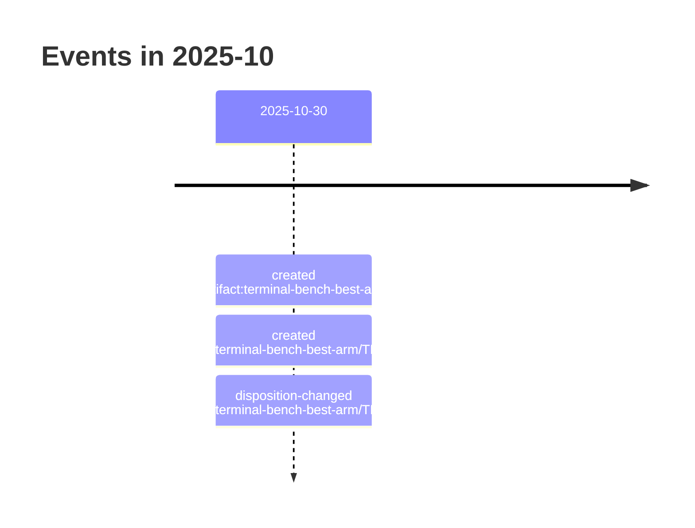

# 2025-10

3 dated event(s). Every date carries the rung that produced it; a date
the resolver could not establish is absent from this page rather than guessed onto it.

## Events

- `2025-10-30` — created of Terminal-Bench — scegliere il braccio migliore e svilupparlo (`artifact:terminal-bench-best-arm`), from a commit touching the file
- `2025-10-30` — created of TBA-05 — Benchmark privato stile Terminal-Bench (condizionale) (`ticket:terminal-bench-best-arm/TBA-05`), from a commit touching the file
- `2025-10-30` — disposition-changed of TBA-05 — Benchmark privato stile Terminal-Bench (condizionale) (`ticket:terminal-bench-best-arm/TBA-05`), from a rename recorded in Git
