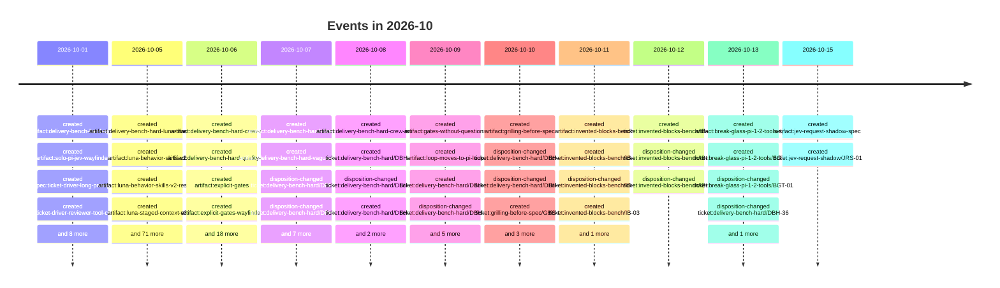

# 2026-10

157 dated event(s). Every date carries the rung that produced it; a date
the resolver could not establish is absent from this page rather than guessed onto it.

## Events

- `2026-10-01` — created of delivery-bench difficile — Opus 5.5: catene da 1, 4 e 12 (`artifact:delivery-bench-hard-opus`), from a commit touching the file
- `2026-10-01` — created of Solo Pi + Jev: una sessione per la catena (`artifact:solo-pi-jev-wayfinder`), from a commit touching the file
- `2026-10-01` — created of Ticket Driver — un prompt oltre il limite della riga di comando (`spec:ticket-driver-long-prompt`), from a commit touching the file
- `2026-10-01` — created of Ticket Driver — le cache degli strumenti del revisore diretto (`spec:ticket-driver-reviewer-tool-caches`), from a commit touching the file
- `2026-10-01` — created of DBH-20 — Misurare con Opus 5.5 (`ticket:delivery-bench-hard/DBH-20`), from a commit touching the file
- `2026-10-01` — created of SPJ-01 — Verificare il trasporto di una sessione Pi lungo la catena (`ticket:solo-pi-jev/SPJ-01`), from a commit touching the file
- `2026-10-01` — created of SPJ-02 — Confermare il fallback quando Jev non decide (`ticket:solo-pi-jev/SPJ-02`), from a commit touching the file
- `2026-10-01` — created of SPJ-03 — Confermare il contratto della review nel contesto condiviso (`ticket:solo-pi-jev/SPJ-03`), from a commit touching the file
- `2026-10-01` — created of SPJ-04 — Confermare gli owner di worktree, prove e integrazione (`ticket:solo-pi-jev/SPJ-04`), from a commit touching the file
- `2026-10-01` — created of SPJ-05 — Provare due richieste con una sessione e giudizi fake (`ticket:solo-pi-jev/SPJ-05`), from a commit touching the file
- `2026-10-01` — created of TDL-01 — Il prompt oltre il limite della riga di comando passa da un file della sessione (`ticket:ticket-driver-long-prompt/TDL-01`), from a commit touching the file
- `2026-10-01` — created of TDC-01 — Le cache degli strumenti non sono scritture del revisore diretto (`ticket:ticket-driver-reviewer-tool-caches/TDC-01`), from a commit touching the file
- `2026-10-05` — created of delivery-bench-hard: Luna su tre bracci, con lotto visibile dal vivo (`artifact:delivery-bench-hard-luna-three-arms`), from a commit touching the file
- `2026-10-05` — created of Luna search — behavior skills v2 (`artifact:luna-behavior-skills-v2`), from a commit touching the file
- `2026-10-05` — created of Behavior-skills v2 — Luna medium L4 (`artifact:luna-behavior-skills-v2-results`), from a commit touching the file
- `2026-10-05` — created of Luna — staged writer and request context v3 (`artifact:luna-staged-context-v3`), from a commit touching the file
- `2026-10-05` — created of Matt Pocock skills 1.3 parity refresh (`artifact:mattpocock-skills-1-3-parity`), from a commit touching the file
- `2026-10-05` — created of Durable ticket claims across Pi sessions (`artifact:pi-multi-session-claims`), from a commit touching the file
- `2026-10-05` — created of Pi Messenger between live Pi sessions on Windows (`artifact:pi-multi-session-messenger-live`), from a commit touching the file
- `2026-10-05` — created of Pi multi-session protocol (`artifact:pi-multi-session-protocol`), from a commit touching the file
- `2026-10-05` — created of Pi multi-session work with Pi Messenger (`artifact:pi-multi-session-wayfinder`), from a commit touching the file
- `2026-10-05` — created of Skills evidence candidate — first executable revision (`artifact:skills-evidence-candidate`), from a commit touching the file
- `2026-10-05` — created of Skills evidence candidate — Luna L4 results (`artifact:skills-evidence-luna-results`), from a commit touching the file
- `2026-10-05` — created of Skills-only as the default lane, plus a direct lane for small changes (`artifact:skills-only-default-lane`), from a commit touching the file
- `2026-10-05` — created of Short handoff instead of a full Verification Record in skills-only (`artifact:skills-only-light-handoff`), from a commit touching the file
- `2026-10-05` — created of Integrazione dell'archivio solo Pi + Jev senza cambiare il comportamento distribuito (`artifact:solo-pi-jev-archive-integration`), from a commit touching the file
- `2026-10-05` — created of Solo Pi + Jev — prova della catena con fake (`artifact:solo-pi-jev-chain-prototype`), from a commit touching the file
- `2026-10-05` — created of Coverage input — correggere il gate prima del port (`artifact:solo-pi-jev-coverage-input`), from a commit touching the file
- `2026-10-05` — created of Solo Pi + Jev — contratto implementativo confermato (`artifact:solo-pi-jev-implementation`), from a commit touching the file
- `2026-10-05` — created of Ammissione e rinnovo della capacità di lancio (`artifact:solo-pi-jev-launch-admission`), from a commit touching the file
- `2026-10-05` — created of Luna Yjs L4 — una misura sul braccio SPB-08 (`artifact:solo-pi-jev-luna-adjudicated-l4`), from a commit touching the file
- `2026-10-05` — created of Luna adjudicated L4 — SPB-09, admission-gated (`artifact:solo-pi-jev-luna-adjudicated-l4-results`), from a commit touching the file
- `2026-10-05` — created of Luna corretto — Yjs L4 e confronto storico (`artifact:solo-pi-jev-luna-corrected-l4-results`), from a commit touching the file
- `2026-10-05` — created of Benchmark Luna — solo braccio persistente corrente, tre scenari L4 (`artifact:solo-pi-jev-luna-current-arm-benchmark`), from a commit touching the file
- `2026-10-05` — created of Benchmark Luna con il braccio Pi + Jev corrente (`artifact:solo-pi-jev-luna-current-arm-results`), from a commit touching the file
- `2026-10-05` — created of Solo Pi + Jev — pilota Luna del candidato persistente (`artifact:solo-pi-jev-luna-pilot`), from a commit touching the file
- `2026-10-05` — created of Luna Pi + Jev — riconciliazione e preparazione della sola prova corretta L4 (`artifact:solo-pi-jev-luna-reentry-preparation`), from a commit touching the file
- `2026-10-05` — created of Luna Yjs L4 — benchmark minimo del braccio e repair loop (`artifact:solo-pi-jev-luna-repair-loop`), from a commit touching the file
- `2026-10-05` — created of Yjs L4 — retest versionato dopo SPB-12 (`artifact:solo-pi-jev-luna-repair-loop-r5-results`), from a commit touching the file
- `2026-10-05` — created of Yjs L4 — minimo del braccio e repair loop, SPB-11 (`artifact:solo-pi-jev-luna-repair-loop-results`), from a commit touching the file
- `2026-10-05` — created of Solo Pi + Jev — pilota Luna L4 (`artifact:solo-pi-jev-luna-results`), from a commit touching the file
- `2026-10-05` — created of Luna Yjs — retry singolo e riduzione del lavoro operatore (`artifact:solo-pi-jev-luna-retry`), from a commit touching the file
- `2026-10-05` — created of Retry Luna Yjs — risultato e lavoro operatore (`artifact:solo-pi-jev-luna-retry-results`), from a commit touching the file
- `2026-10-05` — created of Findings non-blocker — correggere l'ammissione della review (`artifact:solo-pi-jev-review-admission`), from a commit touching the file
- `2026-10-05` — created of Review admission — correzione locale SPB-08 (`artifact:solo-pi-jev-review-admission-results`), from a commit touching the file
- `2026-10-05` — created of Solo Pi + Jev — come si rilegge e corregge il codice (`artifact:solo-pi-jev-review-decision`), from a commit touching the file
- `2026-10-05` — created of Solo Pi + Jev — chi gestisce lavoro, prove e ripresa (`artifact:solo-pi-jev-script-ownership-decision`), from a commit touching the file
- `2026-10-05` — created of SPJ-01: trasporto e lifecycle di una sessione Pi di catena (`artifact:solo-pi-jev-session-transport`), from a commit touching the file
- `2026-10-05` — created of Public failure has priority over review-format uncertainty (`artifact:solo-pi-jev-test-failure-priority`), from a commit touching the file
- `2026-10-05` — created of Solo Pi + Jev — decisione sul fallback (`artifact:solo-pi-jev-uncertainty-decision`), from a commit touching the file
- `2026-10-05` — created of DBH-21 — Profili di estensioni per braccio, legati al lotto, e preflight (`ticket:delivery-bench-hard/DBH-21`), from a commit touching the file
- `2026-10-05` — disposition-changed of DBH-21 — Profili di estensioni per braccio, legati al lotto, e preflight (`ticket:delivery-bench-hard/DBH-21`), from a rename recorded in Git
- `2026-10-05` — created of DBH-22 — Viewer dal vivo del lotto, sul terminale (`ticket:delivery-bench-hard/DBH-22`), from a commit touching the file
- `2026-10-05` — disposition-changed of DBH-22 — Viewer dal vivo del lotto, sul terminale (`ticket:delivery-bench-hard/DBH-22`), from a rename recorded in Git
- `2026-10-05` — created of DBH-23 — Misurare Luna su tre bracci e scrivere il report (`ticket:delivery-bench-hard/DBH-23`), from a commit touching the file
- `2026-10-05` — created of DBH-24 — Il giudice aspetta Docker, e ogni richiesta lascia il suo diff (`ticket:delivery-bench-hard/DBH-24`), from a commit touching the file
- `2026-10-05` — created of LEC-02 — build and test behavior-skills v2 (`ticket:luna-behavior-skills-v2/LEC-02`), from a commit touching the file
- `2026-10-05` — created of MP13-01 — Grilling in rounds (`ticket:mattpocock-skills-1-3-parity/MP13-01`), from a commit touching the file
- `2026-10-05` — created of MP13-02 — Session retro for Pi (`ticket:mattpocock-skills-1-3-parity/MP13-02`), from a commit touching the file
- `2026-10-05` — created of MP13-03 — Skills-only PR body (`ticket:mattpocock-skills-1-3-parity/MP13-03`), from a commit touching the file
- `2026-10-05` — created of MP13-04 — Domain-modeling triggers (`ticket:mattpocock-skills-1-3-parity/MP13-04`), from a commit touching the file
- `2026-10-05` — created of MP13-05 — User-invoked skill guard (`ticket:mattpocock-skills-1-3-parity/MP13-05`), from a commit touching the file
- `2026-10-05` — created of PMS-01 — Live two-session Pi Messenger check on Windows (`ticket:pi-multi-session-wayfinder/PMS-01`), from a commit touching the file
- `2026-10-05` — created of PMS-02 — Durable ticket claim across sessions (`ticket:pi-multi-session-wayfinder/PMS-02`), from a commit touching the file
- `2026-10-05` — created of PMS-03 — Confirm the multi-session coordination protocol (`ticket:pi-multi-session-wayfinder/PMS-03`), from a commit touching the file
- `2026-10-05` — created of PMS-04 — Write the multi-session protocol into the skills (`ticket:pi-multi-session-wayfinder/PMS-04`), from a commit touching the file
- `2026-10-05` — created of LEC-01 — create and test the skills evidence candidate (`ticket:skills-evidence-candidate/LEC-01`), from a commit touching the file
- `2026-10-05` — created of SDL-01 — Default skills-only lane and direct lane for small changes (`ticket:skills-only-default-lane/SDL-01`), from a commit touching the file
- `2026-10-05` — created of SLH-01 — Short skills-only handoff instead of a full Verification Record (`ticket:skills-only-light-handoff/SLH-01`), from a commit touching the file
- `2026-10-05` — created of LIN-01 — Integrare l'archivio pi-lec03 a comportamento invariato (`ticket:solo-pi-jev-archive-integration/LIN-01`), from a commit touching the file
- `2026-10-05` — created of SPC-01 — Sessione RPC persistente e accounting della catena (`ticket:solo-pi-jev-implementation/SPC-01`), from a commit touching the file
- `2026-10-05` — created of SPC-02 — Catena locale con prove osservate e gate tipati (`ticket:solo-pi-jev-implementation/SPC-02`), from a commit touching the file
- `2026-10-05` — created of SPC-03 — Bridge command del judge in-process (`ticket:solo-pi-jev-implementation/SPC-03`), from a commit touching the file
- `2026-10-05` — created of SPB-01 — Braccio persistente del benchmark e prova nativa Luna (`ticket:solo-pi-jev-luna-pilot/SPB-01`), from a commit touching the file
- `2026-10-05` — created of SPB-02 — Pilota Luna L4 e rapporto locale (`ticket:solo-pi-jev-luna-pilot/SPB-02`), from a commit touching the file
- `2026-10-05` — created of SPB-03 — Riparare i confini di osservazione dopo il pilota Luna (`ticket:solo-pi-jev-luna-pilot/SPB-03`), from a commit touching the file
- `2026-10-05` — created of SPB-04 — Riconciliare i costi e preparare una prova corretta L4 (`ticket:solo-pi-jev-luna-pilot/SPB-04`), from a commit touching the file
- `2026-10-05` — created of SPB-05 — Eseguire la catena corretta Yjs L4 e confrontare i vecchi Luna (`ticket:solo-pi-jev-luna-pilot/SPB-05`), from a commit touching the file
- `2026-10-05` — created of SPB-06 — Input coverage attribuito e bounded senza perdere artefatti (`ticket:solo-pi-jev-luna-pilot/SPB-06`), from a commit touching the file
- `2026-10-05` — created of SPB-07 — Un solo retry Luna e lavoro operatore misurato (`ticket:solo-pi-jev-luna-pilot/SPB-07`), from a commit touching the file
- `2026-10-05` — created of SPB-08 — Adjudicare i findings non-blocker (`ticket:solo-pi-jev-luna-pilot/SPB-08`), from a commit touching the file
- `2026-10-05` — created of SPB-09 — Una sola misura Yjs L4 sul braccio corretto (`ticket:solo-pi-jev-luna-pilot/SPB-09`), from a commit touching the file
- `2026-10-05` — created of SPB-10 — Rinnovare capacità e validare prima del launch (`ticket:solo-pi-jev-luna-pilot/SPB-10`), from a commit touching the file
- `2026-10-05` — created of SPB-11 — Benchmark minimo reale del braccio Yjs L4 (`ticket:solo-pi-jev-luna-pilot/SPB-11`), from a commit touching the file
- `2026-10-05` — created of SPB-12 — Test fallito non bloccato da review-format (`ticket:solo-pi-jev-luna-pilot/SPB-12`), from a commit touching the file
- `2026-10-05` — created of SPB-13 — Benchmark minimo reale del braccio Yjs L4 (`ticket:solo-pi-jev-luna-pilot/SPB-13`), from a commit touching the file
- `2026-10-05` — created of SPB-14 — Eseguire il benchmark Luna sul braccio corrente (`ticket:solo-pi-jev-luna-pilot/SPB-14`), from a commit touching the file
- `2026-10-06` — created of Bracci Crew: un principale e i suoi worker pi-messenger (`artifact:delivery-bench-hard-crew-arms`), from a commit touching the file
- `2026-10-06` — created of Giudizio di qualità oltre i test nascosti (`artifact:delivery-bench-hard-quality-judge`), from a commit touching the file
- `2026-10-06` — created of Gate espliciti, per tentativo, senza legami di versione (`artifact:explicit-gates`), from a commit touching the file
- `2026-10-06` — created of Gate espliciti, per tentativo, senza legami di versione (`artifact:explicit-gates-wayfinder`), from a commit touching the file
- `2026-10-06` — created of Blocchi citati e percorso diretto misurato (`artifact:lane-discipline`), from a commit touching the file
- `2026-10-06` — created of Comando `/loop`: ripetere un comando all'infinito (`artifact:pi-code-loop-command`), from a commit touching the file
- `2026-10-06` — created of DBH-28 — Unità di giudizio, alberi ricostruiti e robustezza (`ticket:delivery-bench-hard/DBH-28`), from a commit touching the file
- `2026-10-06` — created of DBH-29 — Copertura dei test limitata alla diff (`ticket:delivery-bench-hard/DBH-29`), from a commit touching the file
- `2026-10-06` — disposition-changed of DBH-29 — Copertura dei test limitata alla diff (`ticket:delivery-bench-hard/DBH-29`), from a rename recorded in Git
- `2026-10-06` — created of DBH-30 — Forza dei test: mutation limitata alla diff (`ticket:delivery-bench-hard/DBH-30`), from a commit touching the file
- `2026-10-06` — disposition-changed of DBH-30 — Forza dei test: mutation limitata alla diff (`ticket:delivery-bench-hard/DBH-30`), from a rename recorded in Git
- `2026-10-06` — created of DBH-31 — Revisione Opus 5.5 alla cieca (`ticket:delivery-bench-hard/DBH-31`), from a commit touching the file
- `2026-10-06` — disposition-changed of DBH-31 — Revisione Opus 5.5 alla cieca (`ticket:delivery-bench-hard/DBH-31`), from a rename recorded in Git
- `2026-10-06` — created of DBH-32 — Pilota e giudizio completo (`ticket:delivery-bench-hard/DBH-32`), from a commit touching the file
- `2026-10-06` — created of DBH-33 — Copia corretta di pi-messenger per il benchmark (`ticket:delivery-bench-hard/DBH-33`), from a commit touching the file
- `2026-10-06` — disposition-changed of DBH-33 — Copia corretta di pi-messenger per il benchmark (`ticket:delivery-bench-hard/DBH-33`), from a rename recorded in Git
- `2026-10-06` — created of DBH-34 — Bracci crew-1 e crew-2 nel runner (`ticket:delivery-bench-hard/DBH-34`), from a commit touching the file
- `2026-10-06` — created of EG-01 — `## Gates` chiesti e scritti in spec e ticket (`ticket:explicit-gates/EG-01`), from a commit touching the file
- `2026-10-06` — created of EG-02 — Budget e tempo per tentativo, nessun legame di versione (`ticket:explicit-gates/EG-02`), from a commit touching the file
- `2026-10-06` — disposition-changed of EG-02 — Budget e tempo per tentativo, nessun legame di versione (`ticket:explicit-gates/EG-02`), from a rename recorded in Git
- `2026-10-06` — created of LD-01 — Blocchi citati e percorso diretto misurato (`ticket:lane-discipline/LD-01`), from a commit touching the file
- `2026-10-06` — created of PCL-01 — Estensione `/loop` nel pacchetto agent-skills (`ticket:pi-code-loop-command/PCL-01`), from a commit touching the file
- `2026-10-07` — created of Catene da 12: pi-tools, pi-full e bare-goal su richieste lunghe (`artifact:delivery-bench-hard-chain-12`), from a commit touching the file
- `2026-10-07` — created of Richieste vaghe con un utente simulato (`artifact:delivery-bench-hard-vague-requests`), from a commit touching the file
- `2026-10-07` — disposition-changed of DBH-32 — Pilota e giudizio completo (`ticket:delivery-bench-hard/DBH-32`), from a rename recorded in Git
- `2026-10-07` — disposition-changed of DBH-34 — Bracci crew-1 e crew-2 nel runner (`ticket:delivery-bench-hard/DBH-34`), from a rename recorded in Git
- `2026-10-07` — created of DBH-35 — Lotto Crew e confronto con pi-tools (`ticket:delivery-bench-hard/DBH-35`), from a commit touching the file
- `2026-10-07` — disposition-changed of DBH-35 — Lotto Crew e confronto con pi-tools (`ticket:delivery-bench-hard/DBH-35`), from a rename recorded in Git
- `2026-10-07` — created of DBH-36 — Lotto delle catene da 12 (`ticket:delivery-bench-hard/DBH-36`), from a commit touching the file
- `2026-10-07` — created of DBH-37 — Richieste vaghe per i tre scenari (`ticket:delivery-bench-hard/DBH-37`), from a commit touching the file
- `2026-10-07` — disposition-changed of DBH-37 — Richieste vaghe per i tre scenari (`ticket:delivery-bench-hard/DBH-37`), from a rename recorded in Git
- `2026-10-07` — created of DBH-38 — Strumento ask_user e utente simulato nel runner (`ticket:delivery-bench-hard/DBH-38`), from a commit touching the file
- `2026-10-07` — disposition-changed of DBH-38 — Strumento ask_user e utente simulato nel runner (`ticket:delivery-bench-hard/DBH-38`), from a rename recorded in Git
- `2026-10-08` — created of Crew che funziona: un team con ruoli, worktree separati, skills-only (`artifact:delivery-bench-hard-crew-isolated`), from a commit touching the file
- `2026-10-08` — created of DBH-40 — Skill crew-delivery (`ticket:delivery-bench-hard/DBH-40`), from a commit touching the file
- `2026-10-08` — disposition-changed of DBH-40 — Skill crew-delivery (`ticket:delivery-bench-hard/DBH-40`), from a rename recorded in Git
- `2026-10-08` — created of DBH-41 — Braccio crew-3 nel runner (`ticket:delivery-bench-hard/DBH-41`), from a commit touching the file
- `2026-10-08` — created of DBH-42 — Lotto crew-3 e confronto (`ticket:delivery-bench-hard/DBH-42`), from a commit touching the file
- `2026-10-08` — created of DBH-43 — Condizione del `/goal` senza la premessa «TASK.md ha cambiado» (`ticket:delivery-bench-hard/DBH-43`), from a commit touching the file
- `2026-10-09` — created of Gate senza domande inutili (`artifact:gates-without-questions`), from a commit touching the file
- `2026-10-09` — created of `/loop` esce da agent-skills: vive solo in `@carlitose86/pi-loop` (`artifact:loop-moves-to-pi-loop`), from a commit touching the file
- `2026-10-09` — created of DBH-39 — Lotto con richieste vaghe e report (`ticket:delivery-bench-hard/DBH-39`), from a commit touching the file
- `2026-10-09` — disposition-changed of DBH-39 — Lotto con richieste vaghe e report (`ticket:delivery-bench-hard/DBH-39`), from a rename recorded in Git
- `2026-10-09` — disposition-changed of DBH-41 — Braccio crew-3 nel runner (`ticket:delivery-bench-hard/DBH-41`), from a rename recorded in Git
- `2026-10-09` — created of DBH-44 — I container avviati dall'agente non sopravvivono alla richiesta (`ticket:delivery-bench-hard/DBH-44`), from a commit touching the file
- `2026-10-09` — created of GQ-01 — Gate di default, senza domande (`ticket:gates-without-questions/GQ-01`), from a commit touching the file
- `2026-10-09` — created of LPM-01 — Togliere l'estensione `/loop` da agent-skills (`ticket:loop-moves-to-pi-loop/LPM-01`), from a commit touching the file
- `2026-10-09` — disposition-changed of LPM-01 — Togliere l'estensione `/loop` da agent-skills (`ticket:loop-moves-to-pi-loop/LPM-01`), from a rename recorded in Git
- `2026-10-10` — created of Grilling prima della spec quando mancano requisiti (`artifact:grilling-before-spec`), from a commit touching the file
- `2026-10-10` — disposition-changed of DBH-42 — Lotto crew-3 e confronto (`ticket:delivery-bench-hard/DBH-42`), from a rename recorded in Git
- `2026-10-10` — disposition-changed of DBH-43 — Condizione del `/goal` senza la premessa «TASK.md ha cambiado» (`ticket:delivery-bench-hard/DBH-43`), from a rename recorded in Git
- `2026-10-10` — created of GBS-01 — Requisiti aperti: `grilling -> to-spec` (`ticket:grilling-before-spec/GBS-01`), from a commit touching the file
- `2026-10-10` — disposition-changed of GBS-01 — Requisiti aperti: `grilling -> to-spec` (`ticket:grilling-before-spec/GBS-01`), from a rename recorded in Git
- `2026-10-10` — created of GBS-02 — Condizione concreta per `grilling -> to-spec` (`ticket:grilling-before-spec/GBS-02`), from a commit touching the file
- `2026-10-10` — disposition-changed of GBS-02 — Condizione concreta per `grilling -> to-spec` (`ticket:grilling-before-spec/GBS-02`), from a rename recorded in Git
- `2026-10-11` — created of Blocchi inventati: benchmark corto e correzione (`artifact:invented-blocks-bench`), from a commit touching the file
- `2026-10-11` — created of IB-01 — Benchmark corto sui blocchi inventati (`ticket:invented-blocks-bench/IB-01`), from a commit touching the file
- `2026-10-11` — disposition-changed of IB-01 — Benchmark corto sui blocchi inventati (`ticket:invented-blocks-bench/IB-01`), from a rename recorded in Git
- `2026-10-11` — created of IB-03 — `/loop` si ferma dopo giri senza novità (`ticket:invented-blocks-bench/IB-03`), from a commit touching the file
- `2026-10-11` — created of IB-04 — Senza remote il target è il ramo locale (`ticket:invented-blocks-bench/IB-04`), from a commit touching the file
- `2026-10-12` — created of IB-02 — Controllo a fine turno sui blocchi (`ticket:invented-blocks-bench/IB-02`), from a commit touching the file
- `2026-10-12` — disposition-changed of IB-02 — Controllo a fine turno sui blocchi (`ticket:invented-blocks-bench/IB-02`), from a rename recorded in Git
- `2026-10-12` — disposition-changed of IB-04 — Senza remote il target è il ramo locale (`ticket:invented-blocks-bench/IB-04`), from a rename recorded in Git
- `2026-10-13` — created of Break Glass recovery tools on Pi 1.2.0 and with pi-agent-ide (`artifact:break-glass-pi-1-2-tools-spec`), from a commit touching the file
- `2026-10-13` — created of BGT-01 — Recovery tools on Pi 1.2.0 and pi-agent-ide (`ticket:break-glass-pi-1-2-tools/BGT-01`), from a commit touching the file
- `2026-10-13` — disposition-changed of BGT-01 — Recovery tools on Pi 1.2.0 and pi-agent-ide (`ticket:break-glass-pi-1-2-tools/BGT-01`), from a rename recorded in Git
- `2026-10-13` — disposition-changed of DBH-36 — Lotto delle catene da 12 (`ticket:delivery-bench-hard/DBH-36`), from a rename recorded in Git
- `2026-10-13` — disposition-changed of IB-03 — `/loop` si ferma dopo giri senza novità (`ticket:invented-blocks-bench/IB-03`), from a rename recorded in Git
- `2026-10-15` — created of Jev request shadow: log whether each user request is precise or vague (`artifact:jev-request-shadow-spec`), from a commit touching the file
- `2026-10-15` — created of JRS-01 — Jev request shadow extension (`ticket:jev-request-shadow/JRS-01`), from a commit touching the file
