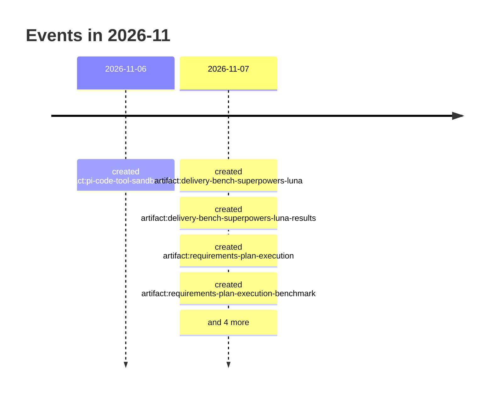

# 2026-11

9 dated event(s). Every date carries the rung that produced it; a date
the resolver could not establish is absent from this page rather than guessed onto it.

## Events

- `2026-11-06` — created of El sandbox del `code` tool promete módulos que no entrega y pierde el estado que dice conservar (`artifact:pi-code-tool-sandbox-defects`), from a commit touching the file
- `2026-11-07` — created of Superpowers su Pi: confronto con Luna medium (`artifact:delivery-bench-superpowers-luna`), from a commit touching the file
- `2026-11-07` — created of Superpowers su Pi con Luna medium — risultati del lotto contemporaneo (`artifact:delivery-bench-superpowers-luna-results`), from a commit touching the file
- `2026-11-07` — created of Esecuzione da requisiti e piano, senza ticket intermedi (`artifact:requirements-plan-execution`), from a commit touching the file
- `2026-11-07` — created of Requisiti e piano su Pi-full — confronto con i bracci già misurati (`artifact:requirements-plan-execution-benchmark`), from a commit touching the file
- `2026-11-07` — created of SPL-01 — Superpowers su Pi, isolato e verificabile offline (`ticket:delivery-bench-superpowers-luna/SPL-01`), from a commit touching the file
- `2026-11-07` — created of SPL-02 — Misurare Superpowers e controlli contemporanei con Luna medium (`ticket:delivery-bench-superpowers-luna/SPL-02`), from a commit touching the file
- `2026-11-07` — created of SPL-03 — Rilocare estensioni congelate senza modificare Pi personale (`ticket:delivery-bench-superpowers-luna/SPL-03`), from a commit touching the file
- `2026-11-07` — created of PLX-01 — Intake da piano e ciclo di qualità condiviso (`ticket:requirements-plan-execution/PLX-01`), from a commit touching the file
